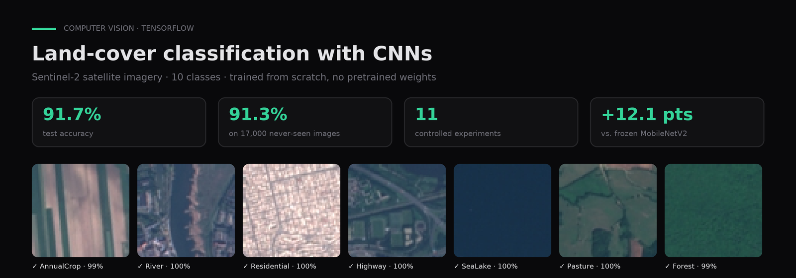
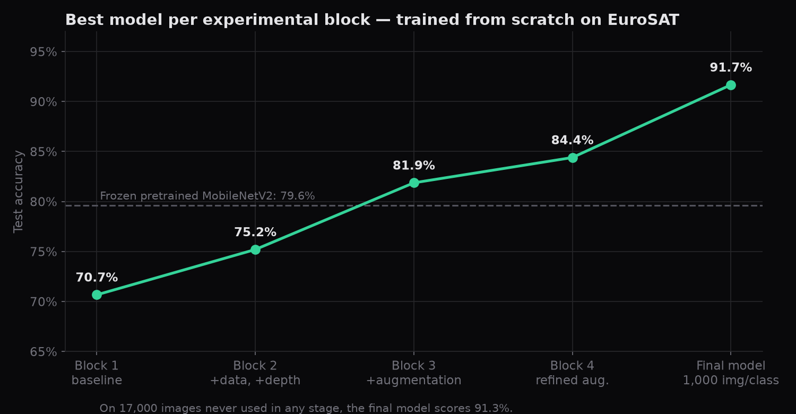
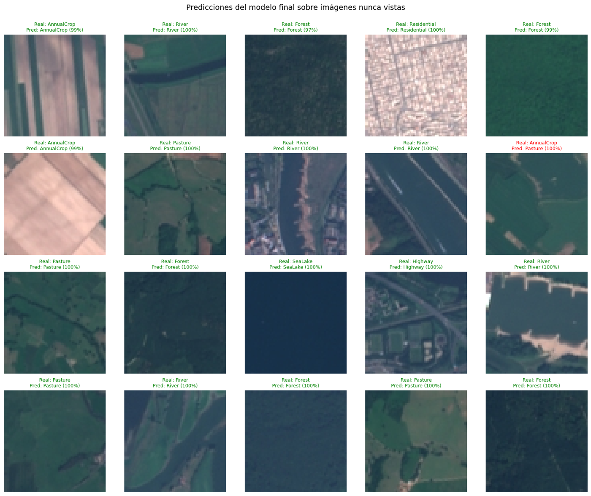

# Land-cover classification from satellite imagery with CNNs

**A convolutional network trained from scratch that classifies Sentinel-2 satellite images into 10 land-cover classes, reaching 91.7% test accuracy and 91.3% on 17,000 images it never saw.**

`Python` · `TensorFlow / Keras` · `scikit-learn` · `Computer vision` · [Leer en español ↓](#español)

---

## Problem

Land-use maps (crops, forests, rivers, highways, urban areas) are useful for agriculture, environmental monitoring and urban planning, but labeling satellite imagery by hand does not scale. The goal was to build a classifier that does it automatically, **without relying on a pretrained network**, and to understand which decisions actually move accuracy.

## Data

[EuroSAT RGB](https://github.com/phelber/EuroSAT): 27,000 labeled 64×64 RGB images from the Sentinel-2 satellite (Copernicus program, ESA), across 10 classes: AnnualCrop, Forest, HerbaceousVegetation, Highway, Industrial, Pasture, PermanentCrop, Residential, River and SeaLake.

The dataset is not included in this repo. Download `EuroSAT.zip` from the official source and upload it when the notebook asks for it.

## Approach

The work runs as a controlled experiment: **11 CNNs across 4 blocks, changing one variable at a time** and writing down a conclusion after each run.

| Block | What changed | Best test accuracy |
|---|---|---|
| 1 | Baseline CNN, 300 images per class; dropout and BatchNorm tested | 70.7% |
| 2 | 500 images per class, an extra convolutional block | 75.2% |
| 3 | Data augmentation, double convolutional blocks | 81.9% |
| 4 | Refined augmentation (90° rotations, flips, soft zoom) | 84.4% |
| Final | Winning architecture scaled to 1,000 images per class | **91.7%** |

Other decisions along the way:
- **Stratified 70/15/15 splits** and EarlyStopping on validation loss, restoring the best weights.
- **Confusion matrix and visual error analysis**: most mistakes are River ↔ Highway and between crop types, which are genuinely hard to tell apart at 64×64.
- **Benchmark against transfer learning**: a frozen ImageNet MobileNetV2 reached 79.6%, so the from-scratch model beats it.
- **A stress test on unseen data**: the final model was evaluated on the 17,000 images that never took part in training, validation or testing.

## Results

- **91.7% test accuracy** (macro F1 0.92) with a 1.34M-parameter CNN trained from scratch.
- **91.3% on 17,000 never-seen images**. That almost matches the test score, so the model generalizes rather than memorizing its test set.
- **The key finding:** more data beat every architecture change. Going from 500 to 1,000 images per class added 7.3 points, more than any other change.
- Weakest classes on the unseen set: HerbaceousVegetation (F1 0.86) and PermanentCrop (0.85). They are visually close to other vegetation classes.

<b>Sample predictions on never-seen images</b> (green = correct, red = error)

## How to run

1. Open the notebooks in [Google Colab](https://colab.research.google.com/) with a GPU runtime, or locally with `pip install -r requirements.txt`.
2. Download `EuroSAT.zip` (RGB version) from the [official repository](https://github.com/phelber/EuroSAT).
3. Run them in order:
   - `notebooks/01_problem_and_eda.ipynb`: problem definition, dataset choice and EDA.
   - `notebooks/02_experiments.ipynb`: the 11 experimental models.
   - `notebooks/03_final_model.ipynb`: the full experiment plus the final model and the unseen-data evaluation. Its last section runs on its own, without retraining the 11 models.

The slides that go with the work (in Spanish) are in [`docs/presentation_es.pdf`](docs/presentation_es.pdf).

## Context

Final integrative project for **Image Processing** in the AI & Data Science program (Colegio Universitario IES · Universidad Siglo 21, 2026). Author: **Gaspar Quintana**.

---

## Español

**Una red convolucional entrenada desde cero que clasifica imágenes del satélite Sentinel-2 en 10 tipos de cobertura del suelo. Llega a 91,7% de accuracy en test y a 91,3% sobre 17.000 imágenes que nunca vio.**

**Problema.** Los mapas de uso del suelo sirven para el agro, el monitoreo ambiental y la planificación urbana, pero etiquetar imágenes satelitales a mano no escala. El objetivo fue construir un clasificador automático **sin usar una red preentrenada** y entender qué decisiones mejoran realmente la accuracy.

**Datos.** EuroSAT RGB: 27.000 imágenes de 64×64 en 10 clases. El dataset no está en el repo: se descarga de la fuente oficial.

**Método.** Un experimento controlado de **11 CNN en 4 bloques**, cambiando una variable por vez (cantidad de datos, dropout, BatchNorm, profundidad y data augmentation), con una conclusión escrita después de cada modelo. El ganador se escaló a 1.000 imágenes por clase y se comparó contra MobileNetV2 preentrenada y congelada (79,6%).

**Resultados.**
- **91,7%** de accuracy en test.
- **91,3%** sobre 17.000 imágenes que no participaron en ninguna etapa.
- El hallazgo principal es que **más datos le ganó a cualquier cambio de arquitectura**: pasar de 500 a 1.000 imágenes por clase sumó 7,3 puntos.

**Contexto.** Trabajo integrador final de **Procesamiento de Imágenes**, Tecnicatura en IA y Ciencia de Datos (Colegio Universitario IES · Universidad Siglo 21, 2026).
